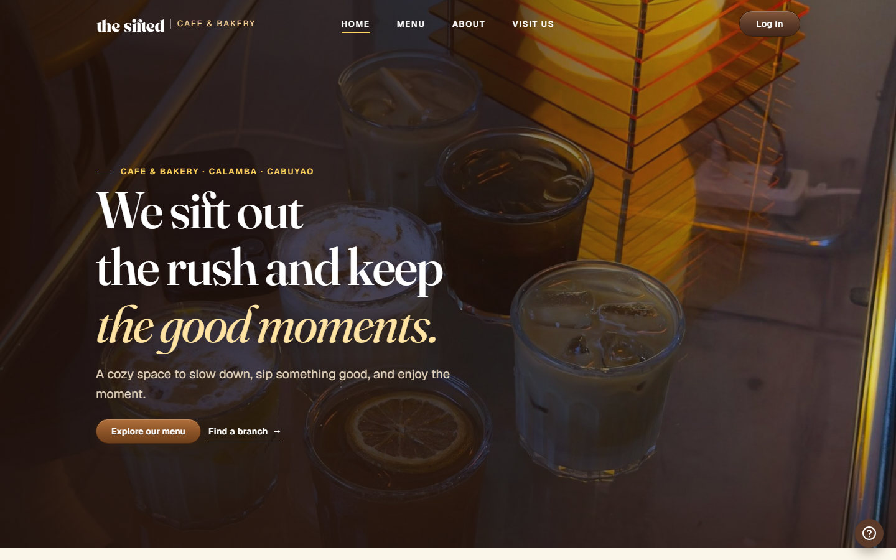
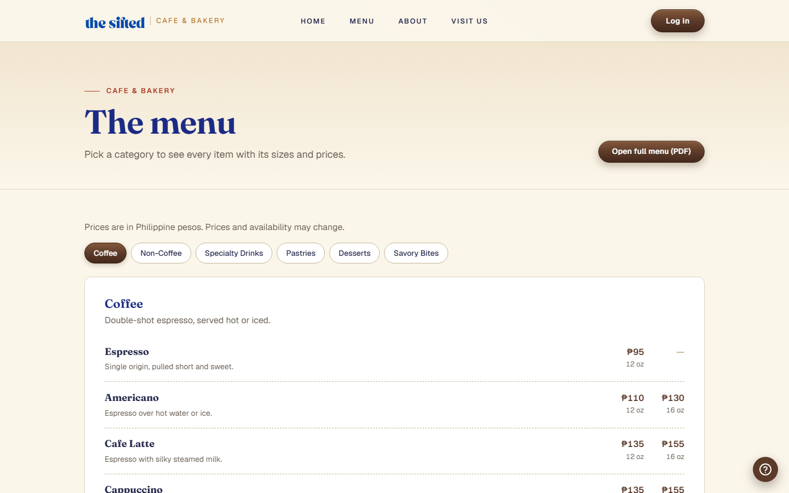
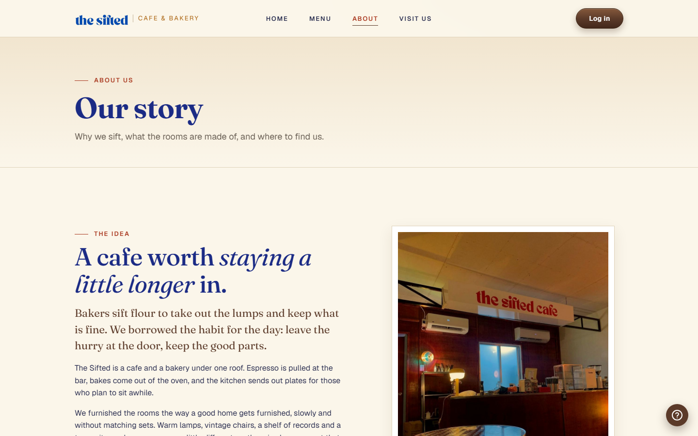

<div align="center">

# The Sifted Cafe & Bakery

**We sift out the rush and keep the good moments.**

A café and bakery in Calamba and Cabuyao, Laguna — with online table reservations,
GCash downpayments, and a staff dashboard.

[**Visit the live site →**](https://thesiftedcafe.vercel.app)

[](https://thesiftedcafe.vercel.app)


[Live site](https://thesiftedcafe.vercel.app) ·
[Features](#what-it-does) ·
[Screenshots](#screenshots) ·
[Tech stack](#tech-stack) ·
[Run locally](#run-it-locally) ·
[Deployment](DEPLOYMENT.md) ·
[Test report](TEST_REPORT.md)

</div>

<p align="center">
  
</p>

## About

The Sifted Cafe is a café and bakery under one roof: espresso pulled at the bar,
bakes coming out of the oven, and plates sent out for people who plan to sit awhile.
This repository is its booking system — a fast static website backed by a small
serverless API and a PostgreSQL database.

Customers create an account, reserve a table at least 24 hours ahead, and pay a
GCash downpayment by uploading proof. Staff verify the payment and manage every
reservation from one dashboard.

> Built as a school project, deployed for real use. The site is live at
> **[thesiftedcafe.vercel.app](https://thesiftedcafe.vercel.app)**.

## What it does

### For customers

- **Accounts** — sign up, log in, reset a forgotten password, and view your profile.
- **Table reservations** — choose a branch, date, time slot, and party size; contact
  details are prefilled from your account.
- **Clear booking rules** — reservations are accepted from **24 hours** up to
  **60 days** ahead, on the hour.
- **GCash downpayment** — a **30% downpayment** is calculated by the server, and a
  screenshot or PDF of the receipt is uploaded to private storage.
- **Reservation history** — follow the status of every booking from *My account* and
  re-upload proof if a payment is rejected.

### For staff

- **Staff-only dashboard** — role-checked in the API and database, not just the UI.
- **Payment verification** — open proof files through short-lived signed links,
  then verify or reject them.
- **Reservation workflow** — confirm, complete, cancel, archive, restore, delete,
  search, filter, and leave notes.
- **One dashboard** — pending, confirmed, and completed bookings in one place.

### Under the hood

- **Server-side rules** — the 24-hour notice, slot capacity, guest limits, and
  pricing all live in PostgreSQL functions. Browser-sent totals are ignored.
- **Concurrency-safe capacity** — simultaneous bookings cannot oversell a slot;
  this is covered by a database test.
- **Row Level Security** — customers can only read their own reservations, and only
  staff can change statuses or read payment proofs.
- **Private uploads** — JPG, PNG, and PDF only, max 3 MB, verified by file contents
  rather than the file extension.
- **Responsive by hand** — every page is plain HTML, CSS, and JavaScript, with no
  front-end framework.

## Screenshots

| Menu | Our story |
|:---:|:---:|
| [](https://thesiftedcafe.vercel.app/menu.html) | [](https://thesiftedcafe.vercel.app/about.html) |
| Coffee, non-coffee drinks, pastries, desserts, and savory bites with sizes and prices. | The story behind the café and a look inside both branches. |

## Tech stack

| Layer | Technology |
|---|---|
| **Frontend** | HTML5, CSS3, vanilla JavaScript |
| **Hosting** | Vercel — static site plus a Node.js serverless function |
| **API** | `api/[...path].js` → `lib/routes.js`, no npm runtime dependencies |
| **Database** | Supabase PostgreSQL with Row Level Security |
| **Auth** | Supabase Auth with HttpOnly cookie sessions |
| **File storage** | Supabase Storage — private `payment-proofs` bucket |
| **Testing** | Node test runner, real PostgreSQL tests, headless Chromium checks |

### How a request flows

```text
Browser (public/)
   │
   │  same-origin /api/*  ·  HttpOnly session cookie
   ▼
Vercel Node.js function (api/[...path].js → lib/routes.js)
   │
   │  Supabase client scoped to the logged-in user
   ▼
Supabase (PostgreSQL + RLS · Auth · private Storage)
```

The browser never receives a Supabase key. The API calls the database **as the
logged-in user**, so Row Level Security applies to every query. The service-role
key is used only for private payment-proof storage.

<details>
<summary><strong>Security details</strong></summary>

- Same-origin API only; the front end never talks to Supabase directly.
- Session is stored in an `HttpOnly`, `SameSite` cookie.
- CSRF protection checks the request origin on state-changing calls.
- Business rules are enforced in database functions, not just in the browser.
- Uploads are content-sniffed; an HTML file renamed to `.png` is rejected and deleted.
- Proof files live in a private bucket and are served through signed links.
- Staff routes return `403` to customer accounts at the API level.

</details>

## Project structure

```text
public/          the website — pages, styles, scripts, images, menu PDF
api/             Vercel function entry point (api/[...path].js)
lib/             server code — routes, sessions, Supabase client, validation, time
supabase/        schema.sql, seed data, and migration notes
tests/           database, API, browser, and page checks
docs/            screenshots used in this README
vercel.json      hosting config and security headers
.env.example     environment variable names only
```

## Run it locally

Nothing to install — the app has no npm dependencies.

```bash
git clone https://github.com/ifwian/the-sifted-cafe.git
cd the-sifted-cafe
cp .env.example .env        # Windows: copy .env.example .env
npm run dev                 # http://localhost:3000
```

`npm run dev` serves `public/` and `/api/*` with the same handler Vercel uses.
Environment variables are read from `.env` or `.env.local` (both git-ignored).

### Environment variables

| Name | Where to get it |
|---|---|
| `SUPABASE_URL` | Supabase → Project Settings → API |
| `SUPABASE_ANON_KEY` | Supabase → Project Settings → API |
| `SUPABASE_SERVICE_ROLE_KEY` | Supabase → Project Settings → API (keep secret) |
| `SITE_URL` | Your deployed address, e.g. `https://thesiftedcafe.vercel.app` |

The database schema is in [`supabase/schema.sql`](supabase/schema.sql). Run it once
in the Supabase SQL editor. Full instructions are in **[DEPLOYMENT.md](DEPLOYMENT.md)**.

## Tests

```bash
node --test tests/*.test.js     # unit tests + API end-to-end (API tests need PostgreSQL)
bash tests/run_db_tests.sh      # schema, RLS, 24-hour rule, capacity, concurrency
node tests/ui-check.js          # reservation form in headless Chromium (needs Playwright)
node tests/pages-check.js       # every page: links, assets, JS errors, mobile layout
```

The full results, including what was tested against real PostgreSQL and what still
needs a live Supabase/Vercel account, are in **[TEST_REPORT.md](TEST_REPORT.md)**.

## Deployment

The site is deployed on Vercel from the `main` branch and uses Supabase for the
database, authentication, and file storage.

1. Create a Supabase project and run `supabase/schema.sql`.
2. Add the four environment variables above to Vercel.
3. Import this repository into Vercel — framework preset **Other**, no build step.
4. Set the Supabase Auth *Site URL* to the deployed address and redeploy.

Step-by-step instructions, including creating the first staff account:
**[DEPLOYMENT.md](DEPLOYMENT.md)**.

## Visit us

| Branch | Address | Hours |
|---|---|---|
| **Calamba** | Unit 2, Pabs2men Building, Chipeco Ave, Brgy. 3, Calamba, 4027 Laguna | Daily, 10:00 AM – 10:00 PM |
| **Cabuyao** | 2nd Floor, Southwalk Commercial Space, South Point, Pulo, Cabuyao, Laguna 4025 | Daily, 9:00 AM – 9:00 PM |

**Phone:** 0916 390 7048 · **Email:** thesiftedcafe@gmail.com

Online bookings are for 2–20 guests at Calamba and 2–30 at Cabuyao. For larger
groups, please call or message the café.

<details>
<summary><strong>Production notes &amp; free-tier limits</strong></summary>

- **Vercel Hobby** is for non-commercial use. A real paying business should move to
  Vercel Pro or another host before launch.
- **Supabase Free** pauses a project after one week of inactivity and has no
  automatic backups. Export the database regularly.
- **Supabase email** is heavily rate-limited. Configure custom SMTP (Resend, Brevo,
  etc.) or disable email confirmation for a first launch.
- **GCash payments are manual.** Staff compare the uploaded screenshot with the
  café's own GCash records; a screenshot can be faked.
- **No rate limiting** beyond Supabase Auth's own. A bot could create junk accounts.
- Capacity is counted per exact hourly slot, matching the original booking rules.

</details>

---

<div align="center">
<sub>Made with care for The Sifted Cafe & Bakery · Calamba &amp; Cabuyao, Laguna</sub>
</div>
